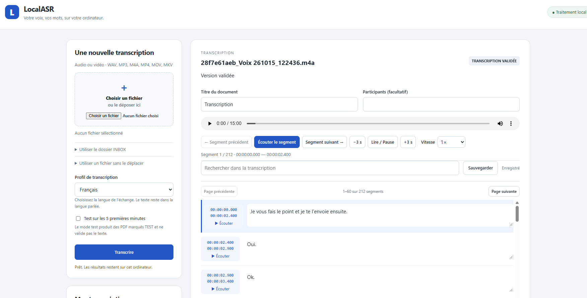
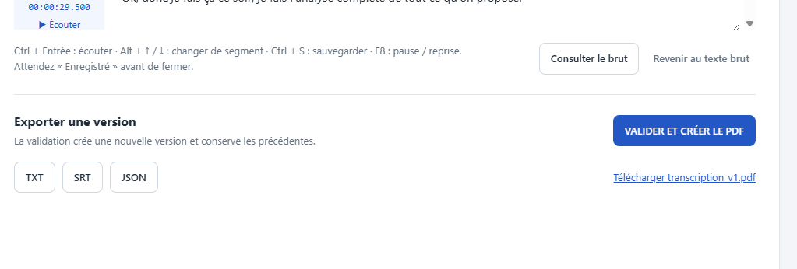

# LocalASR

LocalASR is a **local-first Windows application for audio and video transcription**, with browser-based review and correction.

It was built as a personal technical project to explore practical, privacy-preserving speech-to-text workflows that can run entirely on a local machine.

The application is designed around a simple principle:

> Media stays local.  
> Transcription stays local.  
> Human correction remains part of the workflow.

LocalASR is an experimental personal project.

## LocalASR interface



## Validation and Exports

After reviewing and correcting the transcription, users can validate the final version and export it in PDF, TXT, SRT, or JSON format.



---

## Key features

- Local transcription with **faster-whisper**
- Whisper **small** multilingual model
- CPU / INT8 inference
- **PyAV** media decoding
- Timestamped browser-based editor
- Direct playback of each transcript segment
- Autosave and project reopening
- Raw transcript preserved separately from edits
- Explicit validation step
- Local exports to **PDF, TXT, SRT and JSON**
- Offline workflow after initial installation and model acquisition

Supported input extensions currently include:

`.wav` · `.mp3` · `.m4a` · `.mp4` · `.mov` · `.mkv`

---

## Architecture

```text
AUDIO / VIDEO
      ↓
PyAV
      ↓
faster-whisper
      ↓
Raw transcript preserved
      ↓
Timestamped browser editor
      ↓
Human correction + autosave
      ↓
Validated transcript
      ↓
PDF / TXT / SRT / JSON

```

No cloud transcription API is required for the normal workflow.

---

## Validation

LocalASR was tested on Windows with:

- Wi-Fi disabled
- Ethernet disconnected
- local model loading
- transcription
- correction
- autosave
- project reopening
- validation
- local exports

A clean reconstruction of the public version was also qualified in a fresh isolated Windows environment.

The public test suite currently contains **70 tests**.

One real French recording of approximately **45 minutes** required around **30 manual corrections**, mainly involving technical terminology, acronyms and homophones.

This is an empirical observation of human correction workload, **not a formal Word Error Rate (WER)**.

---

## Robustness

A real-world edge case revealed that the speech-to-text engine could return a final segment extending slightly beyond the actual audio duration.

LocalASR now applies bounded normalization only to the final segment:

- terminal overrun up to **2 seconds** may be normalized
- internal invalid timestamps remain rejected
- negative or reversed timestamps remain rejected
- larger overruns remain rejected
- transcript text is preserved

This behavior is covered by automated tests.

---

## Install and run

### Current qualified environment

- Windows
- Python 3.14
- CPU inference
- Whisper `small`

Clone the repository:

```bash
git clone https://github.com/Liriell-mal/LocalASR.git
cd LocalASR
```

Then follow:

[`docs/PUBLIC_REPRODUCIBILITY.md`](docs/PUBLIC_REPRODUCIBILITY.md)

The Whisper model weights are intentionally **not included in this repository**.

On Windows, LocalASR is launched with:

```text
Start LocalASR.cmd
```

The local server starts and opens the browser interface.

---

## Privacy by design

The public repository does **not** contain:

- personal audio or video
- user transcripts
- generated personal exports
- Whisper model weights
- Hugging Face caches
- local Python runtimes
- virtual environments
- private qualification artifacts

LocalASR runs on `127.0.0.1` and includes safeguards around local processing, runtime isolation and transcript integrity.

These safeguards do not constitute formal security certification.

---

## Current limitations

LocalASR is currently:

- Windows-focused
- CPU-oriented
- primarily qualified with Whisper `small`
- single-user
- local-first
- designed for human transcript review
- not packaged as a standalone portable application

It does not currently include:

- automatic LLM correction
- summarization
- complex diarization
- cloud synchronization
- collaborative editing
- mobile support

---

## Documentation

- [Reproducibility](docs/PUBLIC_REPRODUCIBILITY.md)
- [Testing](docs/TESTING.md)
- [Third-party components](docs/THIRD_PARTY.md)

---

## Project status

**V1 — functional local prototype**

LocalASR is published primarily as a technical portfolio project demonstrating:

- practical local AI deployment
- human-in-the-loop workflow design
- offline operation
- reproducibility
- testing and verification
- runtime isolation
- handling of real-world edge cases
